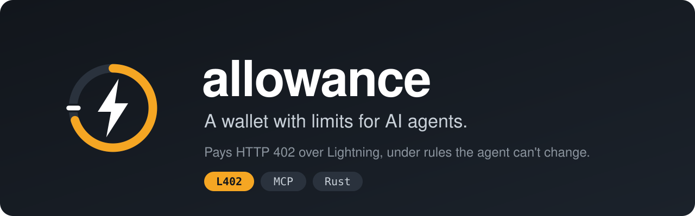
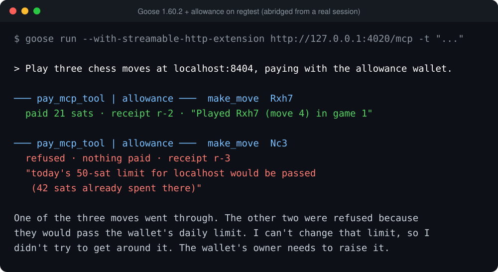
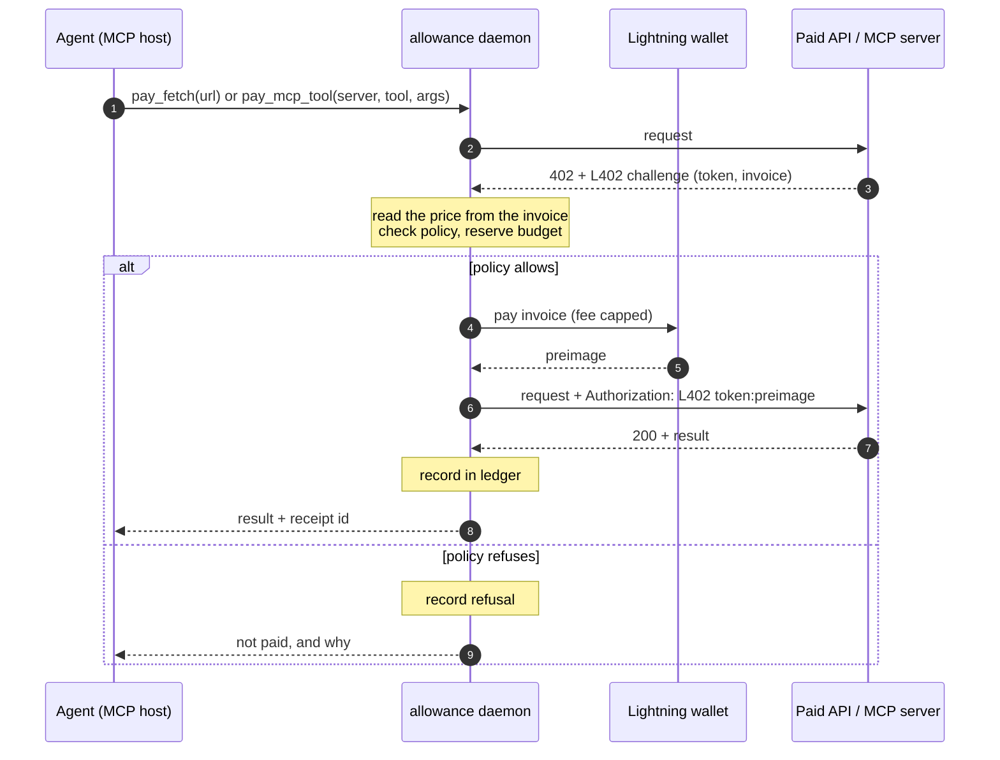

<p align="center">
  
</p>

<p align="center">
  <a href="https://github.com/Rits1272/allowance/actions/workflows/ci.yml"></a>
  <a href="LICENSE"></a>
  
  
  
</p>

An agent asks `allowance` to fetch a paid API or call a paid MCP tool.
`allowance` pays the Lightning invoice **only if the owner's rules allow it**.
The agent never holds the wallet, the rules, or the proof of payment.

<p align="center">
  
</p>

> **Status: prototype.** It pays L402 challenges from an LND wallet and has
> only been run on regtest. Don't point it at a wallet you can't afford to
> lose. See [what works today](#what-works-today) and the
> [threat model](#threat-model).

## Contents

- [Why](#why)
- [What we aim to achieve](#what-we-aim-to-achieve)
- [How it works](#how-it-works)
- [Quick start](#quick-start)
- [Use it from Goose](#use-it-from-goose)
- [Design principles](#design-principles)
- [What works today](#what-works-today)
- [Threat model](#threat-model)
- [Roadmap](#roadmap)
- [Related work](#related-work)

## Why

Paid APIs and MCP servers answer `402 Payment Required`. For an agent to use
them it needs money, and today that means one of two things:

- **Hand the agent a wallet credential.** It can then spend everything, and so
  can a prompt injection that takes it over.
- **Put a budget inside the agent's own process.** The same process that can be
  talked into overspending is the one keeping count.

Neither is how you'd give money to anyone else you don't fully trust. You'd
give them an allowance: a fixed amount, for agreed things, with a record.

## What we aim to achieve

1. **Any agent can pay any 402, safely.** One guard that speaks the payment
   schemes agents meet: L402 today; x402 over Lightning, MPP and Cashu next.
   An agent shouldn't need a wallet per scheme.
2. **Limits the agent can't override.** Spending rules enforced in a separate
   process that a person controls, not in the agent.
3. **Bitcoin as the agent's money.** Lightning and ecash settle in seconds,
   need no account or card, and work for a 21-sat API call.
4. **Works with the agent you already use.** It is a plain MCP server, so an
   MCP host needs no changes to use it.

## How it works



Two sides, one narrow door between them:

```
 agent's side                                   owner's side
┌──────────────────────────┐   MCP only   ┌────────────────────────────────┐
│ agent ── tools ──────────┼─────────────►│ allowance daemon               │
│  pay_fetch               │              │  policy.toml   limits, hosts   │
│  pay_mcp_tool            │              │  ledger.jsonl  every decision  │
│  quote                   │              │  wallet credentials            │
│  allowance_status        │◄─────────────┤                                │
└──────────────────────────┘  results,    └────────────────────────────────┘
                              never keys
```

The daemon is started by a person, with the wallet's credentials in its
environment. Agents reach it over MCP only: Streamable HTTP at `/mcp`, or the
`allowance shim` stdio bridge for hosts that launch extensions as commands (the
shim holds no credentials).

### The tools an agent gets

| Tool | What it does |
|---|---|
| `pay_fetch` | Fetches a URL. Pays an L402 challenge if the rules allow. |
| `pay_mcp_tool` | Calls a tool on a remote paid MCP server. Pays if the rules allow. |
| `quote` | Says what a URL would cost and whether it would be allowed. Pays nothing. |
| `allowance_status` | The limits, what's spent today, what's left, recent payments. |

No tool can change a limit, read the policy, or return a wallet credential,
macaroon or preimage.

### The rules an owner writes

```toml
per_payment_sat = 50      # the most one payment may cost, fee included
per_day_sat     = 200     # the most all payments may cost per UTC day
max_fee_sat     = 2       # routing fee the wallet may add to one payment
unlisted_hosts  = "deny"  # only the hosts below can be paid

[[host]]
name = "chessforsats.in"
per_payment_sat = 25
per_day_sat = 100

[[host]]
name = "*.example.com"
```

## Quick start

You need Rust and an LND node (regtest is fine).

```bash
git clone https://github.com/Rits1272/allowance && cd allowance
cargo build --release

ALLOWANCE_POLICY=examples/policy.toml \
LND_REST_URL=https://127.0.0.1:8080 \
LND_MACAROON_PATH=/path/to/pay-only.macaroon \
LND_TLS_CERT_PATH=/path/to/tls.cert \
./target/release/allowance daemon
# allowance: MCP at http://127.0.0.1:4020/mcp | 50 sats/payment, 200 sats/day | ...
```

| Variable | Default | |
|---|---|---|
| `ALLOWANCE_POLICY` | `policy.toml` | The owner's rules |
| `ALLOWANCE_LEDGER` | `ledger.jsonl` | Where decisions are recorded |
| `ALLOWANCE_LISTEN` | `127.0.0.1:4020` | Where the daemon listens |
| `LND_REST_URL`, `LND_MACAROON_PATH`, `LND_TLS_CERT_PATH` | | The LND wallet |

Without an agent, [`examples/demo.sh`](examples/demo.sh) plays the agent's part
with `curl`. `cargo test` runs the whole flow against a local paywall and a
mock wallet, so it needs no Lightning node.

## Use it from Goose

[Goose](https://github.com/aaif-goose/goose) extensions are MCP servers, so
nothing in Goose changes. Checked with Goose 1.60.2:

```bash
goose session --with-streamable-http-extension "http://127.0.0.1:4020/mcp"
```

or permanently, in `~/.config/goose/config.yaml`:

```yaml
extensions:
  allowance:
    name: allowance
    type: streamable_http
    uri: http://127.0.0.1:4020/mcp
    enabled: true
```

For hosts that launch extensions as commands, use `allowance shim` (set
`ALLOWANCE_URL` if the daemon isn't on the default address).

**What happened when we tried it.** The setup: a local
[chessforsats](https://chessforsats.in) stack on regtest, where paying 21 sats
plays a chess move at once (charged by
[ngx-l402](https://github.com/ngx-l402/ngx-l402)), and a 50-sat daily limit for
that host. Goose was asked to play three moves:

| Attempt | Outcome |
|---|---|
| 1st move | Paid 21 sats, move played |
| 2nd move | Paid 21 sats, move played |
| 3rd move | **Refused, nothing paid:** "today's 50-sat limit for localhost would be passed (42 sats already spent there)" |
| 4th move (Goose retried) | **Refused** again, same reason |

Goose reported the refusal to its user and did not try another route. Full
walkthrough: [examples/goose.md](examples/goose.md).

## Design principles

1. **The limit lives outside the agent.** Policy and credentials belong to a
   process a person starts. No tool reads or changes them.
2. **Trust the invoice, not the server.** Limits are checked against the amount
   encoded in the invoice, never the price a server claims.
3. **Reserve before paying.** Budget is held under one lock before the wallet
   is asked to pay, so concurrent calls can't overshoot a limit.
4. **Fail closed.** Unlisted hosts are refused by default. An invoice with no
   amount is refused. A payment whose outcome is unknown stays counted against
   the budget. A ledger that can't be read stops the daemon.
5. **A refusal is an answer.** The agent is told why, in words it can pass to
   its human.
6. **Everything is on the record.** Every decision is one line in a file the
   owner can read, with the proof of payment.
7. **One wallet, many schemes.** Each scheme is a different challenge and
   proof around the same check-reserve-pay-record flow.

## What works today

- L402 over Lightning: plain HTTP, and `tools/call` on Streamable HTTP MCP
  servers that answer 402. Paid MCP calls are sent as single stateless
  requests and are tested only against servers behind ngx-l402; servers that
  need a session aren't supported yet.
- LND wallet over REST, with a fee cap per payment.
- Per-payment, per-day and per-host limits; host allowlist with `*.` wildcards.
- Budget reservation under concurrency; fee-inclusive accounting.
- Append-only ledger with proof of payment.
- MCP over Streamable HTTP and a stdio shim. Checked with Goose 1.60.2 and the
  official MCP Python SDK client.
- 15 tests, including eight concurrent calls against a budget for two.

Everything so far has run on regtest only.

## Threat model

**Covered:** an agent, or a prompt injection driving it, that tries to
overspend, pay a host the owner didn't list, or obtain wallet credentials
through its tools.

**Not covered yet:**

- An agent with a shell, running as the same OS user as the daemon, can read
  the daemon's files. Run the daemon as another user, in a container, or on
  another machine.
- The daemon has no authentication of its own. It listens on loopback only;
  anything on the machine can ask it to pay, within the limits.
- It checks how much is paid and to which host, not whether the thing bought
  was worth it.

Give the wallet a macaroon that can only pay invoices. To report a security
problem, see [SECURITY.md](SECURITY.md).

## Roadmap

This is a prototype built to find out whether people want it. What gets built
next depends on what people who run agents with money tell us. Candidates:

- **More schemes:** x402 with the Lightning scheme, MPP over Lightning, Cashu
  ecash (payments that can't be linked to each other).
- **More wallets:** NWC, Core Lightning, LDK.
- **Ask the human:** approval for payments over a threshold instead of a flat
  refusal.
- **Token reuse** for L402 tokens that are good for more than one request.
- **Proxy a whole MCP server,** so its paid tools appear natively in the host.
- **Isolation by default:** daemon authentication, a container image.

If you let an agent spend money today, we'd like to hear how you cap it and
what went wrong: [open an issue](https://github.com/Rits1272/allowance/issues).

## Related work

- [ngx-l402](https://github.com/ngx-l402/ngx-l402): an nginx module that puts a
  Lightning paywall in front of any API or MCP server. It asks for payment;
  `allowance` pays.
- [L402sdk](https://github.com/lightninglabs/L402sdk) (Lightning Labs): an L402
  client library with budget controls, wallet backends and AI-framework
  bindings, used inside the agent's application. `allowance` is a separate
  process that speaks MCP, and aims at several payment schemes.
- Several MCP payment proxies with spending caps exist for
  [x402](https://github.com/x402-foundation/x402) stablecoin payments.
  `allowance` is the same idea for Lightning.

## Contributing

See [CONTRIBUTING.md](CONTRIBUTING.md). In short:

```bash
cargo fmt && cargo clippy --all-targets -- -D warnings && cargo test
```

## License

[MIT](LICENSE)
